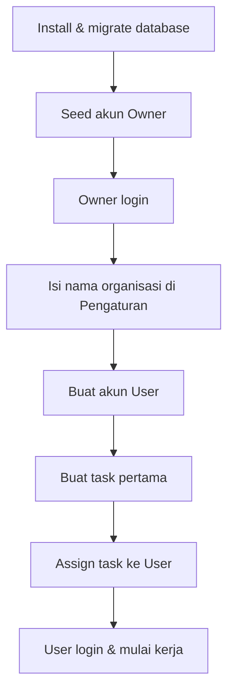
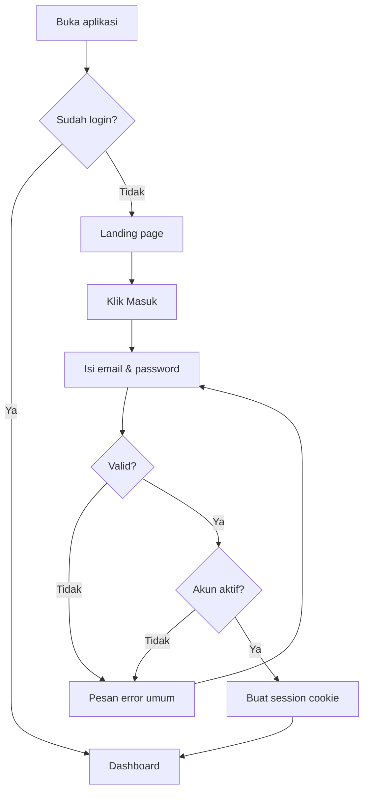
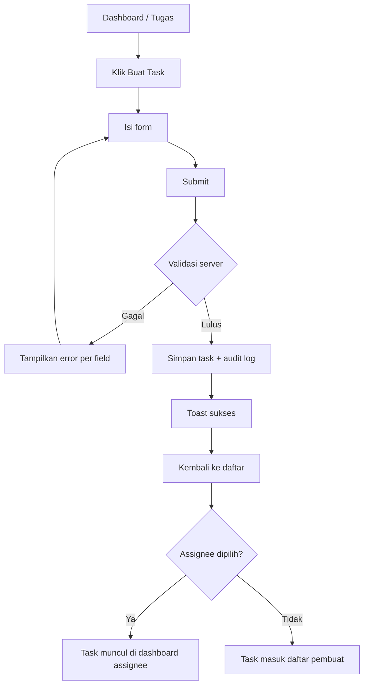
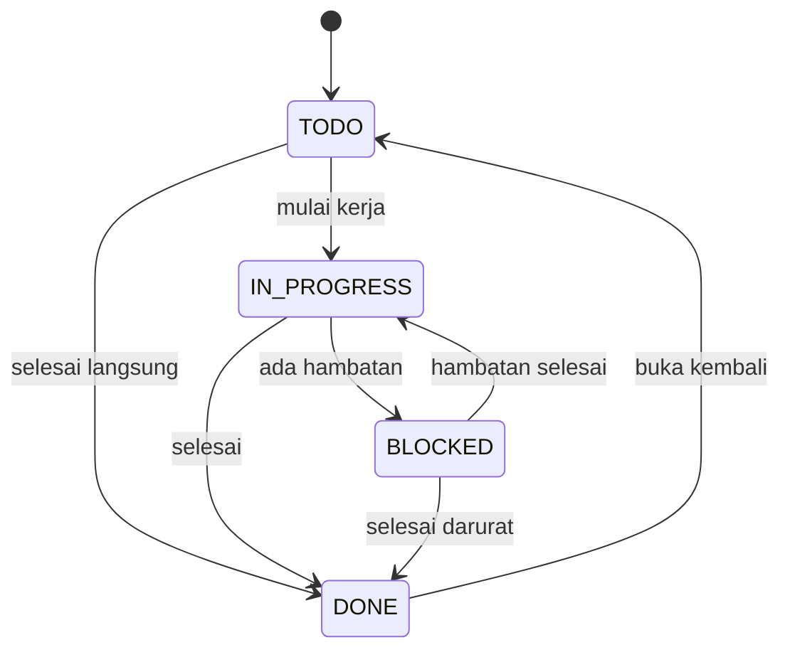
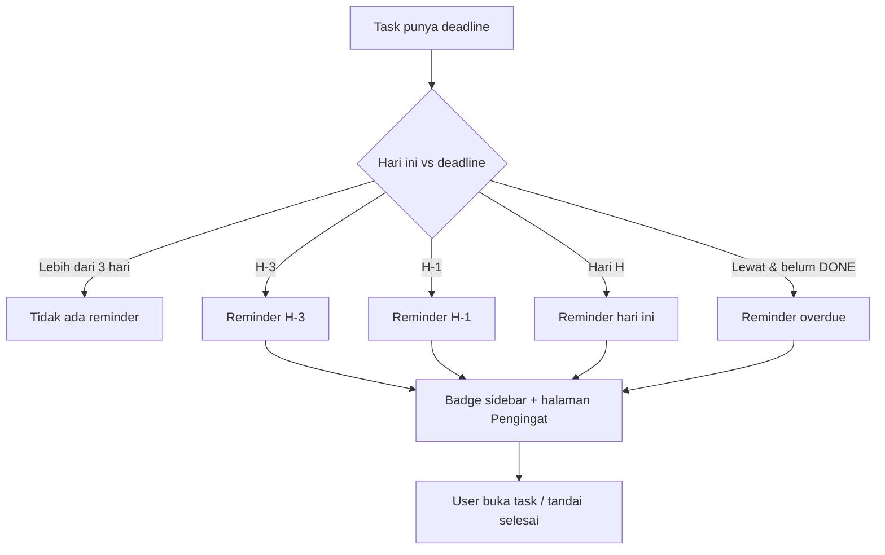
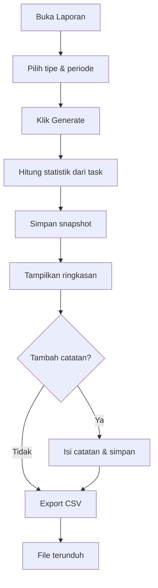
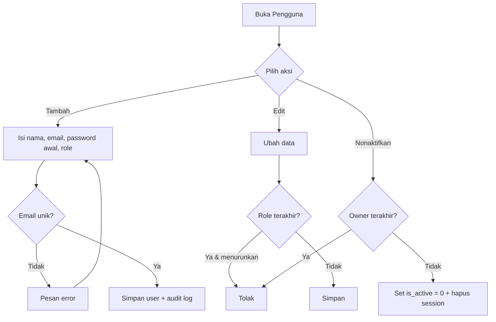

# 07. User Flow / Workflow

## 1. Flow Onboarding Owner (Instalasi Baru)

**Langkah**
1. Developer menjalankan migrasi + seed.
2. Owner menerima email + password awal.
3. Owner login, wajib ganti password.
4. Owner mengisi nama organisasi.
5. Owner menambah user (satu per satu atau beberapa).
6. Owner membuat task dan meng-assign.

**Edge case**
- Email Owner sudah dipakai → seed gagal dengan pesan jelas.
- Owner lupa password → reset lewat CLI developer.

---

## 2. Flow Login

**Aturan**
- Pesan error tidak membedakan "email tidak ada" dan "password salah".
- Setelah 5 kegagalan / 15 menit → blokir sementara.
- Session kedaluwarsa → arahkan ke `/login?next=...`.

---

## 3. Flow Membuat Task

**Target waktu**: ≤ 30 detik dari buka form sampai tersimpan.

---

## 4. Flow Update Status Task

**Langkah**
1. User membuka daftar task (default filter: tugas saya).
2. Klik dropdown status pada baris.
3. Pilih status baru.
4. Sistem menyimpan + mencatat audit log.
5. Jika `DONE`, isi `completed_at`; jika dibuka kembali, kosongkan.

**Aturan**
- Transisi apa pun diizinkan kecuali dari `DONE` ke `BLOCKED` (harus lewat `TODO`/`IN_PROGRESS`).
- Setiap perubahan status tercatat (siapa, kapan, dari → ke).

---

## 5. Flow Assign Task (Owner)

1. Owner membuka detail task.
2. Pilih assignee dari dropdown user aktif.
3. Simpan.
4. Task muncul di dashboard & daftar "Tugas Saya" assignee.
5. Assignee mendapat badge pengingat jika deadline ≤ 3 hari.

**Edge case**
- Assignee dinonaktifkan → task tetap ada, assignee dikosongkan, Owner diberi notifikasi in-app.
- Assignee dihapus (tidak mungkin; hanya nonaktif).

---

## 6. Flow Deadline & Reminder

**Aturan**
- Reminder dihitung saat halaman dimuat (tidak perlu cron di MVP).
- Reminder otomatis tidak disimpan sebagai baris baru; hasil query dari `due_date`.
- Reminder manual disimpan di tabel `reminders`.

---

## 7. Flow Membuat Laporan

**Aturan**
- Periode harian = 00:00–23:59 WIB.
- Mingguan = Senin–Minggu.
- Bulanan = tanggal 1 sampai akhir bulan.
- Snapshot disimpan; perubahan task setelahnya tidak mengubah laporan lama.

---

## 8. Flow Kelola User (Owner)

**Aturan**
- User nonaktif langsung kehilangan session.
- Reset password oleh Owner menghapus session user tersebut.
- Password awal wajib diganti user saat login pertama (`must_change_password`).

---

## 9. Flow Logout & Session Habis

1. User klik avatar → Logout.
2. Server menghapus session di database + cookie.
3. Redirect ke `/login`.
4. Jika session kedaluwarsa saat membuka halaman → redirect ke `/login?next=<path>`.
5. Setelah login, kembali ke `next` jika valid (path internal), selain itu ke dashboard.

---

## 10. Flow Error & Akses Ditolak

| Situasi | Perilaku |
|---|---|
| Buka route tanpa login | Redirect `/login?next=...` |
| User buka `/users` | 403 dengan tautan ke dashboard |
| User buka task orang lain | 404 (jangan bocorkan keberadaan data) |
| Validasi gagal | Form tetap terisi, error per field |
| Server error | Halaman error ramah + tombol coba lagi |
| Data tidak ditemukan | Empty state / 404 |

---

## 11. Acceptance Criteria Flow

- [ ] Semua flow utama bisa diselesaikan tanpa dead-end.
- [ ] Setiap aksi punya feedback (toast/error).
- [ ] Redirect setelah login menghormati `next` hanya untuk path internal.
- [ ] Flow reminder dan laporan tidak membutuhkan cron atau layanan eksternal.
