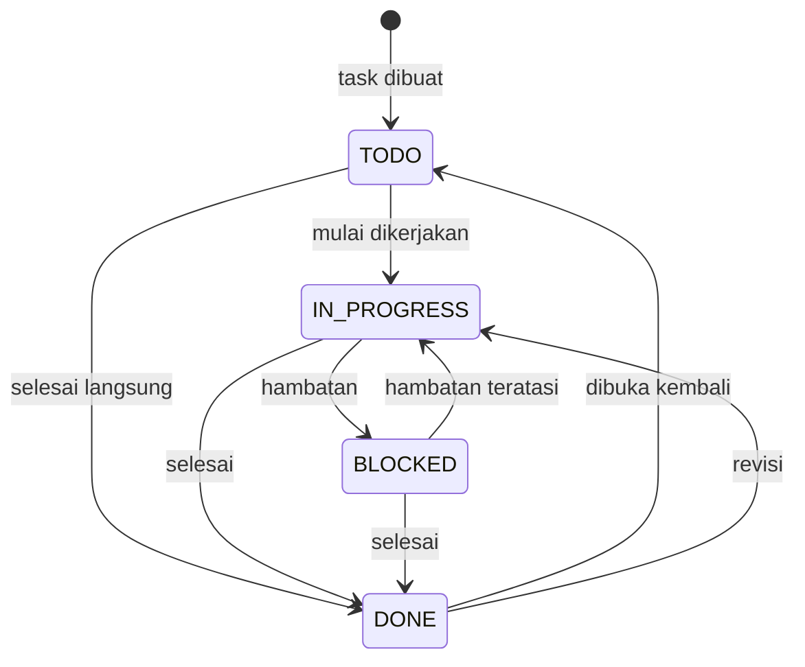

# 09. Business Process

## 1. Ringkasan Proses

| ID | Proses | Aktor | Frekuensi |
|---|---|---|---|
| BP-01 | Onboarding organisasi | Owner | Sekali |
| BP-02 | Pengelolaan akun user | Owner | Sesuai kebutuhan |
| BP-03 | Siklus hidup task | Owner, User | Harian |
| BP-04 | Assignment task | Owner | Harian/mingguan |
| BP-05 | Pengingat deadline | Sistem | Otomatis |
| BP-06 | Pelaporan periodik | User, Owner | Harian/bulanan |
| BP-07 | Audit & pemulihan data | Owner, Developer | Insidental |

---

## 2. BP-01 Onboarding Organisasi

1. Developer menjalankan migrasi database.
2. Developer menjalankan seed untuk membuat akun Owner pertama.
3. Owner login dengan password awal dan **wajib** menggantinya.
4. Owner mengisi nama organisasi.
5. Owner menambahkan user (minimal 1 untuk uji coba).
6. Owner membuat task contoh dan meng-assign.
7. Owner mengundang user untuk login.

**Output**: organisasi siap dipakai, minimal 1 Owner + 1 User.

**Aturan**
- Hanya boleh ada satu proses seed awal; seed ulang harus idempoten atau ditolak.
- Tidak ada email undangan otomatis.

---

## 3. BP-02 Pengelolaan Akun User

### Penambahan
1. Owner membuka Pengguna → Tambah.
2. Owner mengisi nama, email, password awal, role.
3. Sistem memvalidasi email unik.
4. Akun dibuat dengan `must_change_password = 1`.
5. Owner menyampaikan kredensial ke user secara langsung.

### Perubahan
- Owner dapat mengubah nama, email, role.
- Perubahan role Owner → User hanya boleh jika masih ada Owner lain.
- Setiap perubahan dicatat di audit log.

### Penonaktifan
1. Owner menonaktifkan user.
2. Sistem mengisi `is_active = 0` dan menghapus semua session user.
3. Task milik user tetap ada.
4. Task yang di-assign ke user tersebut ditandai "assignee nonaktif" dan bisa dipindahkan Owner.

### Reset Password
- Owner memilih "Reset password", memasukkan password baru.
- Sistem menghapus session user dan menandai `must_change_password = 1`.

---

## 4. BP-03 Siklus Hidup Task

**Aturan**
- Setiap perubahan status wajib mencatat aktor dan waktu.
- `DONE` mengisi `completed_at`.
- Membuka kembali task mengosongkan `completed_at`.
- Task `DONE` tidak muncul di reminder.
- Task `DONE` tetap muncul di daftar jika filter "semua" dipilih.

### Prioritas
| Prioritas | Arti | Target respon |
|---|---|---|
| `URGENT` | Harus segera, menghentikan pekerjaan lain | Hari yang sama |
| `HIGH` | Penting, deadline dekat | ≤ 2 hari |
| `MEDIUM` | Normal | Sesuai deadline |
| `LOW` | Bisa ditunda | Tidak ada SLA |

### Overdue
- Task dianggap overdue jika `due_date < hari ini` **dan** status ≠ `DONE`.
- Overdue bukan status tersimpan; dihitung saat query/tampilan.
- Overdue memperhitungkan zona waktu WIB.

---

## 5. BP-04 Assignment Task

1. Owner memilih task.
2. Owner memilih assignee dari user aktif.
3. Sistem menyimpan `assignee_id` + audit log.
4. Task masuk cakupan assignee.
5. Jika deadline ≤ 3 hari, reminder otomatis muncul di sisi assignee.

**Aturan**
- Satu task hanya punya satu assignee di MVP.
- User biasa tidak bisa memindahkan task ke orang lain.
- Task tanpa assignee tetap terlihat oleh pembuat dan Owner.

---

## 6. BP-05 Pengingat Deadline

| Waktu | Jenis | Aksi sistem |
|---|---|---|
| H-3 | Pengingat awal | Tampil di halaman Pengingat + badge |
| H-1 | Pengingat penting | Tampil + penanda kuning |
| Hari H | Pengingat hari ini | Tampil + penanda oranye |
| H+1 dan seterusnya | Overdue | Tampil + penanda merah |

**Proses**
1. Halaman dimuat → sistem query task dengan `due_date` dalam rentang dan status ≠ `DONE`.
2. Hasil dikelompokkan per jenis.
3. Badge sidebar dihitung dari jumlah pengingat aktif.
4. User membuka task atau menandainya selesai → item hilang dari daftar.

**Aturan**
- Tidak ada pengiriman eksternal.
- Ambang H-3/H-1/H bisa diubah Owner (P1); default tetap.
- Reminder manual mengikuti `remind_at` dan status `PENDING`.

---

## 7. BP-06 Pelaporan Periodik

### Definisi Periode
| Tipe | Mulai | Selesai |
|---|---|---|
| Harian | 00:00 WIB | 23:59:59 WIB |
| Mingguan | Senin 00:00 | Minggu 23:59:59 |
| Bulanan | Tanggal 1 00:00 | Akhir bulan 23:59:59 |

### Metrik Laporan
- Total task pada periode (berdasarkan `created_at`).
- Jumlah selesai (berdasarkan `completed_at` dalam periode).
- Jumlah belum selesai.
- Jumlah overdue pada akhir periode.
- Distribusi per status.
- Distribusi per prioritas.
- Distribusi per assignee (khusus Owner).
- Rata-rata waktu penyelesaian (dari dibuat sampai `DONE`).

### Proses
1. User/Owner memilih tipe + periode.
2. Sistem menghitung metrik dari tabel `tasks`.
3. Sistem menyimpan snapshot ke `reports.stats_json`.
4. User menambahkan catatan (opsional).
5. User mengexport CSV.

**Aturan**
- Snapshot tidak berubah saat data task berubah.
- Generate ulang untuk periode sama membuat baris baru (riwayat) atau menimpa? **Keputusan**: membuat baris baru; user bisa menghapus riwayat lama.
- Laporan kosong tetap bisa digenerate (semua angka 0).

---

## 8. BP-07 Audit Trail

### Aksi yang Dicatat
| Entitas | Aksi |
|---|---|
| Task | create, update, delete, status_change, assign |
| User | create, update, deactivate, activate, reset_password, role_change |
| Report | generate, delete |
| Session | login_success, login_failed, logout, force_logout |
| Settings | update |

### Struktur Log
- `id`, `actor_id`, `action`, `entity_type`, `entity_id`
- `before_json`, `after_json` (data sensitif seperti password **tidak** dicatat)
- `ip`, `user_agent`
- `created_at`

### Aturan
- Audit log tidak bisa diubah/dihapus dari UI.
- Retensi minimal 1 tahun.
- Hanya Owner yang bisa melihat audit log.
- Log ditulis dalam transaksi yang sama dengan perubahan data (jika memungkinkan).

---

## 9. Eskalasi & Pengecualian

| Situasi | Penanganan |
|---|---|
| Assignee nonaktif | Task tetap, assignee dikosongkan, Owner diberi tahu |
| Owner terakhir tidak bisa dihapus | Tombol nonaktifkan dinonaktifkan + pesan |
| Deadline diubah ke masa lalu | Diizinkan saat edit (dengan peringatan), ditolak saat create |
| Laporan periode kosong | Tetap dibuat dengan angka 0 |
| Database terkunci (SQLite busy) | Retry otomatis + pesan "Coba lagi" |
| Data rusak/hilang | Restore dari backup harian |

---

## 10. RACI Ringkas

| Proses | Owner | User | Sistem |
|---|---|---|---|
| Onboarding | A/R | – | I |
| Kelola user | A/R | – | I |
| Buat task | R | R | I |
| Assign task | A/R | – | I |
| Update status | A | R | I |
| Reminder | I | R | A/R |
| Laporan | A | R | R |
| Audit | A/R | – | R |

Keterangan: R = Responsible, A = Accountable, I = Informed.
