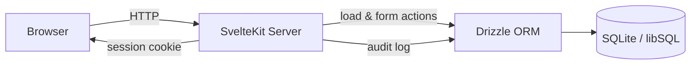
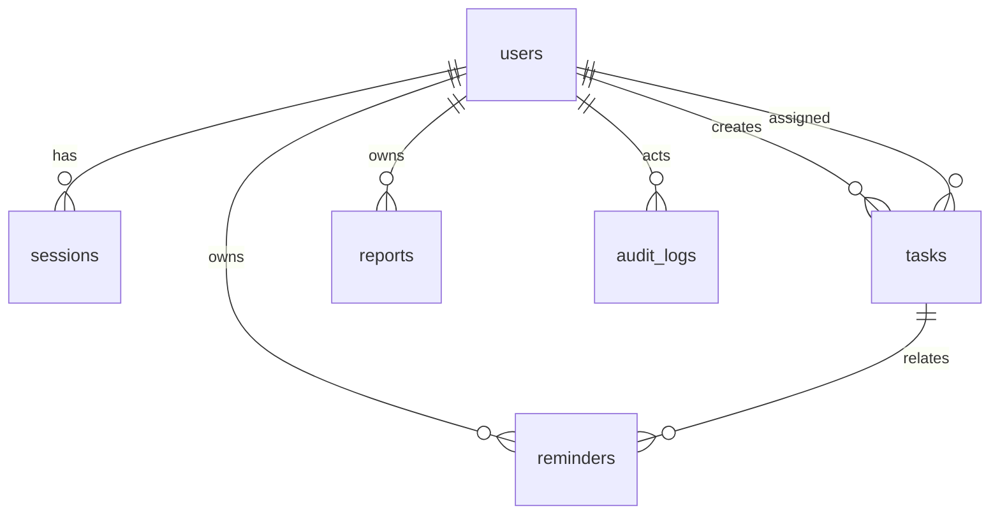

# 10. Technical Stack & Architecture

## 1. Arsitektur

**Modern monolith** — satu aplikasi SvelteKit yang melayani halaman (SSR) dan aksi server. Tidak ada API terpisah untuk MVP.



- Render halaman: SSR + progressive enhancement.
- Mutasi data: **form actions** (`+page.server.js`), bukan `fetch` manual.
- Endpoint JSON (`+server.js`) hanya untuk export CSV dan kebutuhan AJAX (misal ubah status cepat).
- Tidak ada worker/cron di MVP; reminder dan laporan dihitung on-demand.

---

## 2. Stack

| Lapisan | Teknologi | Alasan |
|---|---|---|
| Bahasa | TypeScript | Type safety di frontend & server |
| Framework | **SvelteKit 3 + Svelte 5** | Fullstack, SSR, form actions, adapter fleksibel |
| Runtime | Node.js 26 LTS (min. 24) | Stabil, didukung SvelteKit |
| Styling | Tailwind CSS v4 | Cepat, konsisten |
| Komponen | shadcn-svelte (Bits UI) | Aksesibel, bisa dikustom |
| Design token | Ember Studio (`design/tokens.css`) | Palet & tipografi hangat, konsisten light/dark |
| Ikon | lucide-svelte | Ringan, konsisten |
| Database | **SQLite** (file) | Tanpa server, cukup untuk 1 organisasi |
| Driver | `@libsql/client` | Kompatibel file lokal **dan** Turso |
| ORM | **Drizzle ORM** + drizzle-kit | Typed query, migrasi, mudah pindah ke Postgres nanti |
| Validasi | Zod | Skema validasi server + client |
| Password | argon2id (`@node-rs/argon2`) | Rekomendasi OWASP |
| Session | Tabel `sessions` + cookie acak | Bisa dicabut, tidak perlu JWT |
| Export | CSV generator internal | Tanpa dependensi berat |
| Testing | Vitest + Playwright | Unit + E2E |
| Deploy | VPS (Docker + Caddy) **atau** Vercel + Turso | Lihat bagian 4 |

**Versi acuan saat PRD disusun (Oktober 2026)**: Svelte 5.57 · SvelteKit 3.1 · Tailwind 4.3 · shadcn-svelte 1.7 · Drizzle 0.45 · drizzle-kit 0.31 · libSQL client 0.18 · Zod 4.6 · Vitest 5 · Playwright 1.64 · Node 26.13.

**Catatan**: PostgreSQL tidak dipakai di MVP. Skema ditulis agar mudah dimigrasikan (UUID sebagai TEXT, timestamp ISO-8601).

---

## 3. SQLite: Aturan Pakai

### 3.1 Konfigurasi Wajib

```sql
PRAGMA journal_mode = WAL;      -- baca/tulis paralel lebih baik
PRAGMA foreign_keys = ON;       -- SQLite mematikan FK secara default
PRAGMA busy_timeout = 5000;     -- tunggu 5 detik saat lock
PRAGMA synchronous = NORMAL;    -- aman + cepat dengan WAL
```

Diterapkan pada setiap koneksi baru.

### 3.2 Karakteristik yang Harus Diantisipasi

| Karakter | Dampak | Mitigasi |
|---|---|---|
| Single writer | Tulis bersamaan bisa `SQLITE_BUSY` | WAL + busy_timeout + transaksi pendek |
| Tidak ada tipe tanggal | Perbandingan tanggal rawan | Simpan `TEXT` ISO-8601 UTC / `YYYY-MM-DD` |
| Tidak ada `ILIKE` | Search case-sensitive | `LOWER(col) LIKE LOWER(?)` atau FTS5 (P1) |
| File-based | Tidak cocok filesystem serverless | Lihat bagian 4 |
| Backup | Tidak boleh copy saat menulis | `VACUUM INTO` atau `sqlite3 .backup` |

### 3.3 Aturan Penulisan Query

- Selalu pakai prepared statement (Drizzle otomatis).
- Jangan menyusun SQL dengan interpolasi string.
- Batasi transaksi < 1 detik.
- Untuk laporan, agregasi di SQL, bukan di JavaScript.
- Simpan waktu dalam UTC, konversi ke WIB hanya saat tampil.

### 3.4 Backup

- Harian: `sqlite3 data/mngtask.db ".backup 'backup/mngtask-YYYYMMDD.db'"`
- Retensi 7 hari.
- Uji restore minimal 1x sebelum launch.
- Backup disimpan di luar folder aplikasi.

---

## 4. Deployment

### Opsi A — VPS (direkomendasikan untuk SQLite)

- Docker + volume persisten untuk file `.db`.
- Reverse proxy Caddy (auto HTTPS).
- Backup cron harian.
- Adapter: `@sveltejs/adapter-node`.

```
/app        → kode aplikasi
/data       → volume: mngtask.db
/backup     → volume: backup harian
```

### Opsi B — Vercel + Turso

- Vercel filesystem **ephemeral** — file SQLite akan hilang saat redeploy/scale.
- Gunakan **Turso** (libSQL, kompatibel SQLite) sebagai database.
- Adapter: `@sveltejs/adapter-vercel`.
- `DATABASE_URL=libsql://...` + `DATABASE_AUTH_TOKEN=...`.

### Keputusan MVP

| Lingkungan | Database | Alasan |
|---|---|---|
| Development | File lokal `data/mngtask.db` | Cepat, tanpa setup |
| Production | **VPS + volume** (default) | SQLite asli, biaya rendah, backup mudah |
| Production alternatif | Turso | Jika tetap ingin Vercel |

> Jangan deploy file SQLite ke Vercel tanpa Turso. Data akan hilang.

---

## 5. Environment Variables

| Nama | Wajib | Contoh | Keterangan |
|---|---|---|---|
| `DATABASE_URL` | Ya | `file:./data/mngtask.db` | Lokasi SQLite / URL Turso |
| `DATABASE_AUTH_TOKEN` | Kondisional | `eyJ...` | Hanya untuk Turso |
| `SESSION_SECRET` | Ya | string 32+ byte | Untuk menandatangani cookie |
| `APP_URL` | Ya | `http://localhost:5173` | Base URL, redirect, origin check |
| `NODE_ENV` | Ya | `development`/`production` | Mode aplikasi |
| `TZ` | Tidak | `Asia/Jakarta` | Zona waktu proses |

`.env` tidak boleh di-commit. Sediakan `.env.example`.

---

## 6. Autentikasi & Session

1. Login → verifikasi argon2id.
2. Buat token acak 32 byte (`crypto.randomBytes(32).toString('base64url')`).
3. Simpan **hash** token (SHA-256) di `sessions.token_hash`.
4. Set cookie `session` berisi token asli: `httpOnly`, `secure` (produksi), `sameSite=lax`, `path=/`, `maxAge=7 hari`.
5. Setiap request: hash cookie → cari session valid → muat user.
6. Sliding expiry: perpanjang jika sisa < 3 hari.
7. Logout: hapus baris session + cookie.
8. Ganti password / nonaktifkan user: hapus semua session user.

**Otorisasi**
- `hooks.server.js` memuat user + role ke `event.locals`.
- Guard route: `+layout.server.js` per grup (`(app)`, `(owner)`).
- Setiap form action memeriksa ulang role & kepemilikan data.
- Jangan pernah percaya `userId` dari form; ambil dari session.

---

## 7. Struktur Folder

```
src/
├── app.html
├── app.css
├── hooks.server.ts            # session, security headers
├── lib/
│   ├── components/            # UI (shadcn-svelte + custom)
│   ├── server/
│   │   ├── db/
│   │   │   ├── index.ts       # koneksi libSQL + pragma
│   │   │   ├── schema.ts      # definisi Drizzle
│   │   │   └── queries/       # query per entitas
│   │   ├── auth.ts            # hash, session, guard
│   │   ├── audit.ts
│   │   ├── validation.ts      # skema Zod
│   │   └── csv.ts
│   ├── utils/                 # tanggal, format, konstanta
│   └── types/
├── routes/
│   ├── (public)/              # landing, login
│   ├── (app)/                 # dashboard, tasks, reports, reminders, settings
│   └── (owner)/users/
├── app.d.ts
└── service-worker.ts          # (P1)
drizzle/
└── migrations/                # hasil drizzle-kit generate
drizzle.config.ts              # arahkan schema ke src/lib/server/db/schema.ts
data/
└── mngtask.db                 # tidak di-commit
```

---

## 8. Data Model

Detail DDL ada di [`schema.sql`](./schema.sql).

| Tabel | Isi |
|---|---|
| `users` | Akun, role, status aktif |
| `sessions` | Session login (hash token) |
| `tasks` | Task + status, prioritas, deadline, assignee |
| `reminders` | Reminder manual |
| `reports` | Snapshot laporan + catatan |
| `audit_logs` | Jejak aksi penting |
| `login_attempts` | Rate limiting login |
| `settings` | Pengaturan aplikasi (key/value) |

### Relasi



### Aturan Data

- ID memakai UUID v4 sebagai `TEXT`.
- Waktu: `TEXT` ISO-8601 UTC (`2026-10-31T05:00:00.000Z`).
- Tanggal: `TEXT` `YYYY-MM-DD` (WIB).
- Enum dijaga `CHECK` constraint.
- Soft delete hanya untuk task (`deleted_at`); data lain hard delete.
- `report.stats_json` menyimpan snapshot, bukan hasil hitung ulang.

---

## 9. Migrasi & Seed

```bash
npm run db:generate   # drizzle-kit generate
npm run db:migrate    # terapkan migrasi
npm run db:seed       # buat Owner + data demo
npm run db:reset      # hapus & buat ulang (dev only)
```

**Aturan**
- Setiap perubahan skema = file migrasi baru; jangan edit migrasi lama.
- `schema.sql` adalah referensi; sumber kebenaran tetap `schema.ts` + migrasi.
- Seed idempoten: cek email sebelum insert.
- Seed demo: 1 Owner, 3 User, 12 task (berbagai status & deadline), 3 reminder.

---

## 10. Testing

| Jenis | Tool | Cakupan |
|---|---|---|
| Unit | Vitest | Validasi, util tanggal, perhitungan statistik laporan |
| Integration | Vitest + DB sementara | Query task, guard kepemilikan, session |
| E2E | Playwright | Login, CRUD task, reminder, laporan, kelola user |
| A11y | axe-core | Halaman utama |

Database test memakai file terpisah (`data/test.db`) yang dibuat/dihapus per run.

---

## 11. Target Performa

| Aksi | Target |
|---|---|
| First contentful paint (desktop) | < 1 detik |
| Daftar task 5.000 baris (terpaginasi) | < 300ms |
| Generate laporan bulanan | < 1 detik |
| Simpan task | < 500ms (p95) |
| Ukuran bundle JS awal | < 150KB gzip |

---

## 12. Integrasi Pihak Ketiga

**Tidak ada untuk MVP.** Tidak memakai email service, WA gateway, payment gateway, maps, Firebase, atau storage eksternal.

| Kebutuhan | Solusi MVP |
|---|---|
| Notifikasi | In-app (badge, toast) |
| Export | CSV dibuat di server |
| File | Tidak ada upload |
| Auth | Internal |
| Hosting DB alternatif | Turso (opsional) |

---

## 13. Utang Teknis yang Diterima

| Utang | Alasan | Rencana |
|---|---|---|
| SQLite single-writer | Cukup untuk ≤ 20 user | Migrasi Postgres jika > 50 user |
| Tanpa cron | Reminder on-demand | Tambah worker saat butuh push |
| Tanpa PDF | CSV cukup | P1 dengan renderer |
| Tanpa FTS | Volume task kecil | FTS5 saat > 10.000 task |
| Tanpa multi-tenant | Fokus MVP | Arsitektur ulang jika jadi SaaS |
